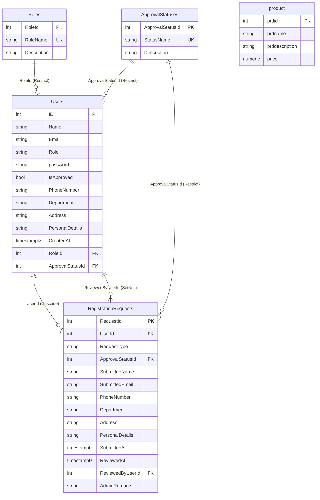
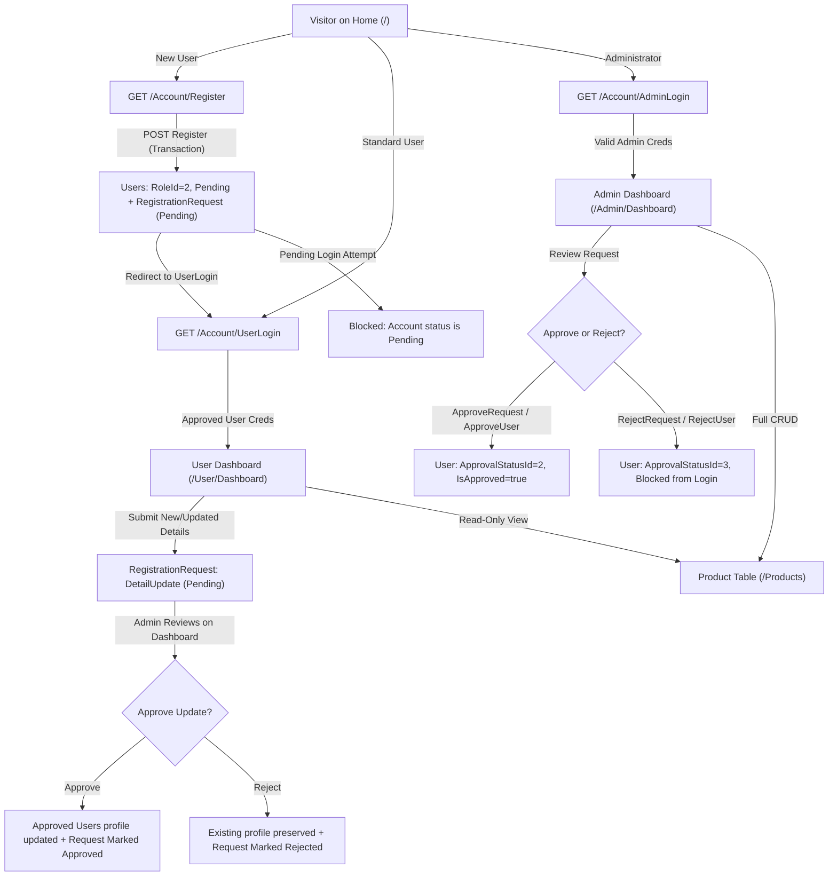

# Admin & User Portal (`WebApplication2`)

An ASP.NET Core 10.0 MVC web application backed by **PostgreSQL** and **Entity Framework Core** featuring role-based authentication and authorization, approval-gated user registration, admin-reviewed user detail update requests, separate role dashboards, and a role-protected Product Table.

---

## Table of Contents

1. [Tech Stack & Key Features](#1-tech-stack--key-features)
2. [Project Structure](#2-project-structure)
3. [Database Schema & Relationships](#3-database-schema--relationships)
4. [Authentication & Security Architecture](#4-authentication--security-architecture)
5. [Core Application Workflows](#5-core-application-workflows)
6. [Route & Endpoint Reference](#6-route--endpoint-reference)
7. [Prerequisites & Setup](#7-prerequisites--setup)
8. [Entity Framework Core Migrations](#8-entity-framework-core-migrations)
9. [Running the Application](#9-running-the-application)
10. [Configuration, Seeding & Troubleshooting](#10-configuration-seeding--troubleshooting)

---

## 1. Tech Stack & Key Features

| Layer | Technology / Package | Version |
| --- | --- | --- |
| Framework | ASP.NET Core MVC (`.NET 10.0`) | `net10.0` |
| ORM | `Microsoft.EntityFrameworkCore` & `Design` | `10.0.14` |
| PostgreSQL Provider | `Npgsql.EntityFrameworkCore.PostgreSQL` | `10.0.3` |
| EF Tooling (CSPROJ) | `Microsoft.EntityFrameworkCore.Tools` | `11.0.0` |
| Authentication | Cookie Authentication (`CookieAuthenticationDefaults`) | Built-in |
| Password Hashing | `IPasswordHasher<Users>` (`PasswordHasher<Users>`, PBKDF2) | Built-in |
| Frontend | Bootstrap 5, jQuery, jQuery Validation & Unobtrusive Validation | Static libs (`wwwroot/lib`) |

### Key Capabilities
- **Separate Admin & User Login System**: Dedicated **Admin Login** (`/Account/AdminLogin`) and **User Login** (`/Account/UserLogin`) options on the shared Login page (`/Account/Login`), authenticating by username or email with PBKDF2 password verification and cross-role isolation.
- **Approval-Gated User Registration**: New users register with personal details (`Name`, `Email`, `PhoneNumber`, `Department`, `Address`, `PersonalDetails`, `Password`) in `Pending` state (`ApprovalStatusId = 1`, `IsApproved = false`) and cannot sign in or access protected routes until approved by an Admin.
- **Admin Dashboard (`/Admin/Dashboard`)**:
  - Summary counters for pending requests, total accounts, approved accounts, and products.
  - Review queue for `Pending` registration and detail-update requests with optional `AdminRemarks`, **Approve** / **Reject** actions, and full user inspection (`/Admin/UserDetails/{id}`).
  - Full account management (**Details**, **Approve**, **Reject**, **Delete**, and **Create Additional Admin**).
  - Product management section integrated with the Product Table.
- **User Dashboard (`/User/Dashboard`)**:
  - Displays current Admin-approved profile details (`Profile`) and a complete status history of submitted requests (`Pending`, `Approved`, `Rejected`, with `AdminRemarks` and review timestamps).
  - Form to submit new or updated personal details (`DetailUpdate` request), which remain isolated from the approved profile until reviewed and approved by an Admin.
- **Role-Protected Product Table (`/Products`)**:
  - **Admin**: Can search, add (`Create`), modify (`Edit`), and delete (`Delete`) products via both Bootstrap modals on `/Products` and dedicated MVC views.
  - **User**: Read-only access to browse and search products; Admin-only UI controls are hidden and direct GET/POST requests to write actions are blocked by the `"AdminOnly"` policy.

---

## 2. Project Structure

```text
WebApplication2/
├── Program.cs                                  # DI registration, DbContext, PasswordHasher, Cookie Auth, Policies, Startup Seeding
├── WebApplication2.csproj                      # Target framework (net10.0) & NuGet packages
├── appsettings.json                            # PostgreSQL ConnectionStrings:DefaultConnection & Logging
├── appsettings.Development.json                # Development logging overrides
├── Properties/
│   └── launchSettings.json                     # Local dev URLs (http://localhost:5133, https://localhost:7013)
├── Controllers/
│   ├── HomeController.cs                       # Home portal, Login redirect, AccessDenied, Error handler
│   ├── AccountController.cs                    # AdminLogin, UserLogin, Login, Register, Logout, AccessDenied
│   ├── AdminController.cs                      # [AdminOnly] Dashboard, UserDetails, Approve/Reject requests & users, DeleteUser, CreateAdmin
│   ├── UserController.cs                       # [UserOnly] User Dashboard & SubmitDetails (creates Pending DetailUpdate requests)
│   └── ProductsController.cs                   # [Admin,User] read-only Index; [AdminOnly] Create, Edit, Delete
├── Models/
│   ├── ApplicationDbContext.cs                 # EF Core DbContext, DbSets, Fluent API relationships, static lookup seeding
│   ├── Users.cs                                # User entity (credentials, approval status, role FK, personal details)
│   ├── Role.cs                                 # Role lookup entity ("Admin", "User")
│   ├── ApprovalStatus.cs                       # Status lookup entity ("Pending", "Approved", "Rejected")
│   ├── RegistrationRequest.cs                  # Registration & DetailUpdate workflow audit/approval table
│   ├── product.cs                              # Existing product catalog entity mapped to table "product"
│   ├── AccountViewModels.cs                    # ViewModels + DataAnnotations for Login, Register, Dashboards, Admin/User forms
│   ├── DbInitializer.cs                        # Safe startup seeder for default Admin when no Admin account exists
│   └── ErrorViewModel.cs                       # Error page request tracing model
├── Migrations/
│   ├── 20261111044657_InitialCreate.cs         # Initial "product" and "Users" tables
│   ├── 20261111062029_AddUserApproval.cs       # Added Users.IsApproved column
│   ├── 20261111090843_update.cs                # Intermediate snapshot sync
│   ├── 20261112040723_AddRolesApprovalAndRegistrationRequests.cs # Roles, ApprovalStatuses, RegistrationRequests, User FKs & legacy sync
│   └── ApplicationDBContextModelSnapshot.cs    # Current EF Core relational model snapshot
├── Views/
│   ├── _ViewImports.cshtml & _ViewStart.cshtml # TagHelpers & shared _Layout wiring
│   ├── Shared/
│   │   ├── _Layout.cshtml                      # Role-aware top navbar (Admin/User login vs role Dashboard, Product Table, Logout)
│   │   ├── _ValidationScriptsPartial.cshtml    # jQuery client-side unobtrusive validation
│   │   └── Error.cshtml                        # Exception fallback page
│   ├── Home/
│   │   ├── Index.cshtml                        # Portal landing page with Admin Login, User Login, and User Registration cards
│   │   └── AccessDenied.cshtml                 # Role-aware 403/Access Denied recovery view
│   ├── Account/
│   │   ├── Login.cshtml                        # Tabbed Admin Login / User Login page
│   │   └── Register.cshtml                     # User self-registration form with personal details
│   ├── Admin/
│   │   ├── Dashboard.cshtml                    # Pending approvals, all users, products management, reviewed history, Create Admin
│   │   └── UserDetails.cshtml                  # Detailed user profile and per-request review history
│   ├── User/
│   │   └── Dashboard.cshtml                    # Approved profile, detail submission form, and request status history
│   └── Products/
│       ├── Index.cshtml                        # Searchable product table + Admin-only Add/Modify/Delete modals
│       ├── Create.cshtml                       # Admin standalone Add Product page
│       ├── Edit.cshtml                         # Admin standalone Modify Product page
│       └── Delete.cshtml                       # Admin standalone Delete confirmation page
└── wwwroot/                                    # Static CSS (site.css), JS (site.js), Bootstrap & jQuery libraries
```

---

## 3. Database Schema & Relationships

Configured in [`ApplicationDBContext`](file:///c:/Users/HP/source/repos/WebApplication2/WebApplication2/Models/ApplicationDbContext.cs) against PostgreSQL database `Admindashboard`.

### Entity-Relationship Diagram



### Table Details

#### `Roles` (`Models/Role.cs`)
Seeded automatically via `HasData`:
| `RoleId` (PK) | `RoleName` (Unique, max 60) | `Description` (max 150) |
| --- | --- | --- |
| `1` | `Admin` | Administrator with full user approval and product management access |
| `2` | `User` | Standard user with personal dashboard and read-only product access |

#### `ApprovalStatuses` (`Models/ApprovalStatus.cs`)
Seeded automatically via `HasData`:
| `ApprovalStatusId` (PK) | `StatusName` (Unique, max 40) | `Description` (max 150) |
| --- | --- | --- |
| `1` | `Pending` | Waiting for Admin review |
| `2` | `Approved` | Approved by Admin |
| `3` | `Rejected` | Rejected by Admin |

#### `Users` (`Models/Users.cs`)
| Column | PostgreSQL Type | Constraints / Defaults | Purpose |
| --- | --- | --- | --- |
| `ID` | `integer` | PK, Identity | Primary user identifier |
| `Name` | `character varying(40)` | Nullable | Username / full name (matched case-insensitively at login) |
| `Email` | `character varying(40)` | Nullable | User email (matched case-insensitively at login) |
| `Role` | `character varying(60)` | Nullable | Legacy/denormalized role label (`"Admin"` / `"User"`) |
| `password` | `character varying(255)` | Nullable | ASP.NET Identity PBKDF2 password hash |
| `IsApproved` | `boolean` | Default `false` | Fast approval flag synced with `ApprovalStatusId` |
| `PhoneNumber` | `character varying(20)` | Nullable | Approved phone number |
| `Department` | `character varying(60)` | Nullable | Approved department or organization |
| `Address` | `character varying(200)` | Nullable | Approved address |
| `PersonalDetails` | `character varying(500)` | Nullable | Approved bio / personal notes |
| `CreatedAt` | `timestamp with time zone` | Default `NOW()` (UTC) | Account creation timestamp |
| `RoleId` | `integer` | FK -> `Roles.RoleId` (`Restrict`), Default `2` | Normalized role foreign key |
| `ApprovalStatusId` | `integer` | FK -> `ApprovalStatuses.ApprovalStatusId` (`Restrict`), Default `1` | Normalized approval state FK |

#### `RegistrationRequests` (`Models/RegistrationRequest.cs`)
| Column | PostgreSQL Type | Constraints / Defaults | Purpose |
| --- | --- | --- | --- |
| `RequestId` | `integer` | PK, Identity | Primary request identifier |
| `UserId` | `integer` | FK -> `Users.ID` (`Cascade`), Required | Submitter account |
| `RequestType` | `character varying(30)` | Required | `"Registration"` or `"DetailUpdate"` |
| `ApprovalStatusId` | `integer` | FK -> `ApprovalStatuses.ApprovalStatusId` (`Restrict`), Default `1` | Request review state (`Pending`/`Approved`/`Rejected`) |
| `SubmittedName` | `character varying(40)` | Nullable | Requested username / full name |
| `SubmittedEmail` | `character varying(40)` | Nullable | Requested email |
| `PhoneNumber` | `character varying(20)` | Nullable | Submitted phone number |
| `Department` | `character varying(60)` | Nullable | Submitted department |
| `Address` | `character varying(200)` | Nullable | Submitted address |
| `PersonalDetails` | `character varying(500)` | Nullable | Submitted personal details |
| `SubmittedAt` | `timestamp with time zone` | Default `NOW()` (UTC) | Submission timestamp |
| `ReviewedAt` | `timestamp with time zone` | Nullable | Decision timestamp (UTC) |
| `ReviewedByUserId` | `integer` | FK -> `Users.ID` (`SetNull`), Nullable | Admin who reviewed the request |
| `AdminRemarks` | `character varying(250)` | Nullable | Optional Admin approval/rejection note |

#### `product` (`Models/product.cs`)
Preserved completely untouched across migrations:
- `prdid` (`integer` PK, Identity)
- `prdname` (`character varying(20)`, Required)
- `prddescription` (`character varying(40)`, Nullable)
- `price` (`numeric`, Required, `Range >= 0`)

---

## 4. Authentication & Security Architecture

### Cookie Authentication & Policies (`Program.cs`)
- **Authentication Scheme**: `CookieAuthenticationDefaults.AuthenticationScheme`
  - `LoginPath = "/Account/Login"`
  - `LogoutPath = "/Account/Logout"`
  - `AccessDeniedPath = "/Account/AccessDenied"`
  - `ExpireTimeSpan = TimeSpan.FromHours(8)` with `SlidingExpiration = true` and `Cookie.HttpOnly = true`
- **Authorization Policies**:
  - `"AdminOnly"` -> `policy.RequireRole("Admin")` (protects `AdminController` and all `ProductsController` write actions)
  - `"UserOnly"` -> `policy.RequireRole("User")` (protects `UserController`)
  - `[Authorize(Roles = "Admin,User")]` on `ProductsController` class level (allows authenticated approved Admins and Users to browse `/Products`)

### Security Controls Implemented
1. **Password Hashing**: Registration (`AccountController.Register`), Admin creation (`AdminController.CreateAdmin`), and seeding (`DbInitializer.SeedAsync`) hash passwords using `IPasswordHasher<Users>`. Login (`AccountController.Login`) verifies hashes via `VerifyHashedPassword` and catches `FormatException` to reject malformed or unhashed entries.
2. **Role-Isolated Login Enforcement**:
   - Submitting through **Admin Login** (`LoginRole = "Admin"`) rejects standard `User` accounts even with valid credentials.
   - Submitting through **User Login** (`LoginRole = "User"`) rejects `Admin` accounts and directs them to **Admin Login**.
3. **Approval Gate at Login & Live Cookie Validation (`OnValidatePrincipal`)**:
   - Rejected (`ApprovalStatusId == 3`) and Pending (`!IsApproved || ApprovalStatusId != 2`) users are denied authentication at login.
   - Every authenticated request re-queries the user via `OnValidatePrincipal` (`AsNoTracking()`); if a user was rejected or deleted while signed in, the cookie principal is immediately rejected and signed out.
4. **Open-Redirect & Cross-Role `ReturnUrl` Protection**:
   - Validates `Url.IsLocalUrl(model.ReturnUrl)` and blocks redirecting back to `/`, `/Account/*`, an Admin to `/User/*`, or a User to `/Admin/*`.
5. **CSRF & Input Validation**:
   - Every `POST` action uses `[ValidateAntiForgeryToken]` paired with `@Html.AntiForgeryToken()` in all forms (including Logout and inline Approve/Reject/Delete forms).
   - Strict DataAnnotations (`[Required]`, `[EmailAddress]`, `[Phone]`, `[MinLength]`, `[MaxLength]`, `[Compare]`, `[Range]`) matched to PostgreSQL column lengths, plus case-insensitive duplicate username/email checks before inserts and updates.
6. **Self-Lockout Guard**:
   - `AdminController.RejectUser` and `AdminController.DeleteUser` prevent the currently signed-in Admin from rejecting or deleting their own active session account.

---

## 5. Core Application Workflows



### Detail Update Isolation Design
When an approved User submits edits via **User Dashboard -> Submit New / Update Details** (`POST /User/SubmitDetails`):
- Existing columns in `Users` (`Name`, `Email`, `PhoneNumber`, `Department`, `Address`, `PersonalDetails`) are **not** immediately modified.
- Instead, a new row is inserted into `RegistrationRequests` with `RequestType = "DetailUpdate"` and `ApprovalStatusId = 1` (`Pending`).
- Only when an Admin clicks **Approve** (`POST /Admin/ApproveRequest/{id}`) does the application verify uniqueness (`Name` / `Email`) and copy the approved values onto the `Users` row.
- Both Admins (`/Admin/UserDetails/{id}`) and Users (`/User/Dashboard`) can inspect the full chronological history and `AdminRemarks`.

---

## 6. Route & Endpoint Reference

| Method | Route | Controller Action | Access Policy | Description |
| --- | --- | --- | --- | --- |
| `GET` | `/` | `HomeController.Index` | Anonymous | Portal home with Admin Login, User Login, Register cards (or Dashboard links when signed in) |
| `GET` | `/Home/Login` | `HomeController.Login` | Anonymous | Redirects to `/Account/Login` |
| `GET` | `/Home/AccessDenied` | `HomeController.AccessDenied` | Anonymous | Access denied page |
| `GET` | `/Home/Error` | `HomeController.Error` | Anonymous | Error view with `ErrorViewModel.RequestId` |
| `GET` | `/Account/Login` | `AccountController.Login` | Anonymous | Shared login page (defaults to User mode unless `?mode=Admin`) |
| `GET`/`POST` | `/Account/AdminLogin` | `AccountController.AdminLogin` | Anonymous | Admin sign-in; redirects to `/Admin/Dashboard` |
| `GET`/`POST` | `/Account/UserLogin` | `AccountController.UserLogin` | Anonymous | User sign-in; redirects to `/User/Dashboard` |
| `GET`/`POST` | `/Account/Register` | `AccountController.Register` | Anonymous | User registration; creates `Users` + `RegistrationRequest` (`Pending`) |
| `POST` | `/Account/Logout` | `AccountController.Logout` | Authenticated | Signs out cookie and redirects to Home |
| `GET` | `/Account/AccessDenied` | `AccountController.AccessDenied` | Anonymous | Cookie auth access-denied target |
| `GET` | `/Admin/Dashboard` | `AdminController.Dashboard` | `AdminOnly` | Main Admin workspace (requests, users, products, create admin) |
| `GET` | `/Admin/UserDetails/{id}` | `AdminController.UserDetails` | `AdminOnly` | Profile & complete request history for user `{id}` |
| `POST` | `/Admin/ApproveRequest/{id}` | `AdminController.ApproveRequest` | `AdminOnly` | Approves pending `Registration` or applies pending `DetailUpdate` |
| `POST` | `/Admin/RejectRequest/{id}` | `AdminController.RejectRequest` | `AdminOnly` | Rejects pending request with optional `remarks` |
| `POST` | `/Admin/ApproveUser/{id}` | `AdminController.ApproveUser` | `AdminOnly` | Approves user account & pending registration requests |
| `POST` | `/Admin/RejectUser/{id}` | `AdminController.RejectUser` | `AdminOnly` | Marks user rejected and blocks future logins/active session |
| `POST` | `/Admin/DeleteUser/{id}` | `AdminController.DeleteUser` | `AdminOnly` | Deletes account (cascades owned `RegistrationRequests`) |
| `POST` | `/Admin/CreateAdmin` | `AdminController.CreateAdmin` | `AdminOnly` | Creates an additional pre-approved Admin account |
| `GET` | `/User/Dashboard` | `UserController.Dashboard` | `UserOnly` | Displays approved profile, update submission form, and request history |
| `POST` | `/User/SubmitDetails` | `UserController.SubmitDetails` | `UserOnly` | Submits a `Pending` `DetailUpdate` request for Admin review |
| `GET` | `/Products` | `ProductsController.Index` | `Admin` or `User` | Displays searchable Product Table (Admin sees Add/Modify/Delete controls; User is read-only) |
| `GET`/`POST` | `/Products/Create` | `ProductsController.Create` | `AdminOnly` | Adds a new product |
| `GET`/`POST` | `/Products/Edit/{id}` | `ProductsController.Edit` | `AdminOnly` | Modifies an existing product |
| `GET`/`POST` | `/Products/Delete/{id}` | `ProductsController.Delete` | `AdminOnly` | Deletes an existing product |

---

## 7. Prerequisites & Setup

1. **Install Prerequisites**:
   - [.NET 10.0 SDK](https://dotnet.microsoft.com/download)
   - [PostgreSQL](https://www.postgresql.org/download/) running on `localhost:5432` (configured for database `Admindashboard`)
   - EF Core CLI tool (if running migrations via CLI):
     ```powershell
     dotnet tool install --global dotnet-ef
     ```

2. **Configure PostgreSQL Connection String**:
   Update `"ConnectionStrings:DefaultConnection"` in [appsettings.json](file:///c:/Users/HP/source/repos/WebApplication2/WebApplication2/appsettings.json) (or use .NET User Secrets / environment variables in production):
   ```json
   {
     "ConnectionStrings": {
       "DefaultConnection": "Host=localhost;Port=5432;Database=Admindashboard;Username=postgres;Password=<your-postgres-password>"
     }
   }
   ```

3. **Restore & Build**:
   ```powershell
   dotnet restore
   dotnet build
   ```

---

## 8. Entity Framework Core Migrations

All migrations are stored in `Migrations/` and target `ApplicationDBContext`:
1. `20261111044657_InitialCreate` — Creates `product` and `Users`.
2. `20261111062029_AddUserApproval` — Adds `Users.IsApproved`.
3. `20261111090843_update` — Snapshot alignment.
4. `20261112040723_AddRolesApprovalAndRegistrationRequests` — Creates `Roles`, `ApprovalStatuses`, `RegistrationRequests`, seeds lookup data, backfills existing `Users` (`Role = 'Admin'` -> `RoleId = 1`, `IsApproved = true` -> `ApprovalStatusId = 2`), adds FKs and indexes, and aligns PostgreSQL serial sequences without touching `product`.

### CLI Commands (`.NET CLI`)

```powershell
# Apply all pending migrations to PostgreSQL
dotnet ef database update

# Create a new migration after editing any entity or ApplicationDBContext
dotnet ef migrations add <MigrationName>

# Generate an idempotent SQL script for manual DB deployment / DBA review
dotnet ef migrations script --idempotent -o migration.sql

# Inspect migration status against the target database
dotnet ef migrations list
```

### Package Manager Console Commands (Visual Studio)

```powershell
Update-Database
Add-Migration <MigrationName>
Script-Migration -Idempotent
```

---

## 9. Running the Application

Run via Visual Studio (`http` / `https` profiles in [launchSettings.json](file:///c:/Users/HP/source/repos/WebApplication2/WebApplication2/Properties/launchSettings.json)) or the .NET CLI:

```powershell
# HTTP profile (http://localhost:5133)
dotnet run --launch-profile http

# HTTPS + HTTP profile (https://localhost:7013 and http://localhost:5133)
dotnet run --launch-profile https
```

### Verification Summary
- Tested against live PostgreSQL `Admindashboard` with pre-existing `Users` and `product` data preserved intact.
- Verified anonymous access redirects, pending/rejected login blocking, role-isolated login enforcement, cross-role `/Account/AccessDenied` blocking, `DetailUpdate` isolation until Admin approval, Admin-only Product Table CRUD vs User read-only access, and live cookie invalidation via `OnValidatePrincipal`.

---

## 10. Configuration, Seeding & Troubleshooting

### Startup Admin Seeding (`Models/DbInitializer.cs`)
On startup, [`DbInitializer.SeedAsync`](file:///c:/Users/HP/source/repos/WebApplication2/WebApplication2/Models/DbInitializer.cs#L8-L50) checks whether an Admin account already exists (`RoleId == 1 || Role == "Admin"`):
- **If an Admin already exists** (e.g., an existing `Admin` row in your PostgreSQL database): seeding does nothing so existing accounts and passwords are untouched.
- **If no Admin exists** (e.g., on a brand-new database): it creates one approved Admin account:
  - **Username**: `admin`
  - **Email**: `admin@admindashboard.local`
  - **Initial Password**: `Admin@123` *(change or replace this immediately in non-local environments)*

### Common Issues
- **PostgreSQL `28P01: password authentication failed`**: Verify the username, password, database name (`Admindashboard`), and port (`5432`) in `appsettings.json` match your local PostgreSQL instance.
- **Database schema out of sync (`42P01` relation does not exist / `42703` column does not exist)**: Run `dotnet ef database update` before signing in or running queries.
- **`Cannot write timestamp with Kind=Unspecified to PostgreSQL type 'timestamp with time zone'`**: Npgsql requires UTC timestamps; all server-generated timestamps in controllers/models use `DateTime.UtcNow`.
- **`CS8981` build warnings on `product` / `update`**: Informational compiler warnings for existing lowercase class names (`Models/product.cs` and `Migrations/20261111090843_update.cs`); preserved intentionally to keep existing schema/class references compatible.
- **Column length limits**: User `Name` and `Email` are limited to `40` characters, and `product.prdname` is limited to `20` characters to match the PostgreSQL table schema.

